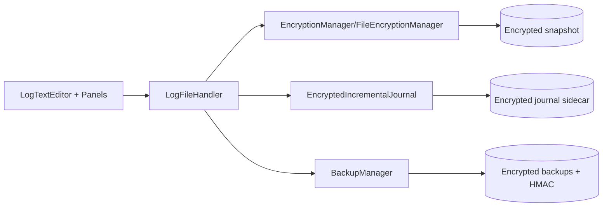
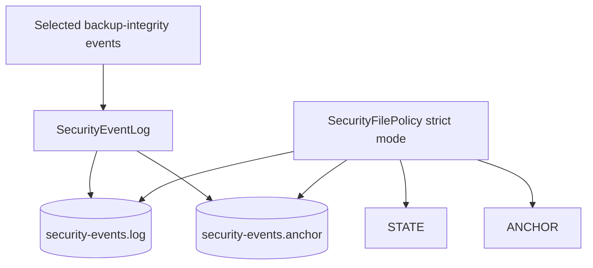
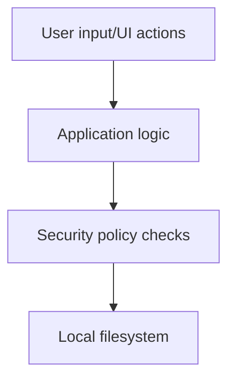

# .LOG-hog Architecture

Short architecture snapshot aligned with current code.

## Core Modules

* UI: `gui/*`, `main/LogTextEditor.java`
* File and entry handling: `filehandling/*`
* Encryption: `encryption/*`
* Security policy/helpers: `security/*`
* Backup and integrity: `main/BackupManager.java`

## Runtime Flow

## Security-Critical Design

* Encrypted-only storage path (plaintext mode removed)
* AES-GCM + PBKDF2 derived keys
* Incremental encrypted journal writes, compacted on lock/threshold
* Numbered backup integrity via HMAC
* Tamper-evident security event log (sequence + hash-chain + anchored metadata)
* Link/file open checks and centralized security path policy gates
* Strict owner-only permission enforcement for security-critical artifacts
* Local metadata-key protection is platform-specific: Windows uses current-user DPAPI when available; macOS/Linux use an AES-GCM-wrapped key whose random master secret is protected by file permissions. The latter is exposed if the app-data directory is copied; neither is hardware-backed.

## Security Persistence Flow

## Trust Boundaries

## Scope / Non-Goals

* Protects local data at rest and against offline tampering/access
* Does not protect against malware, keyloggers, or a fully compromised host
