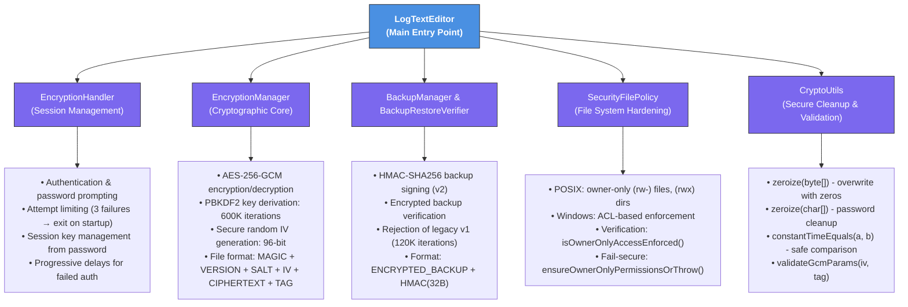
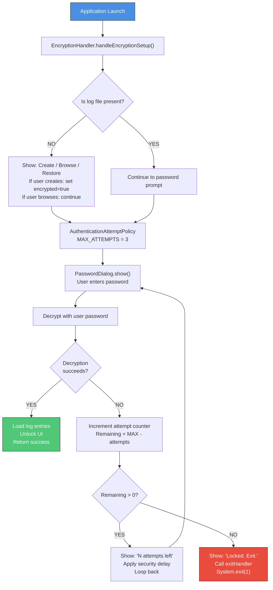
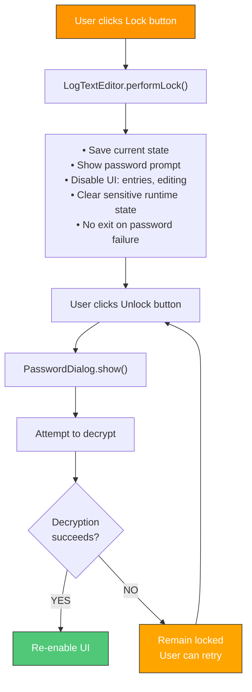
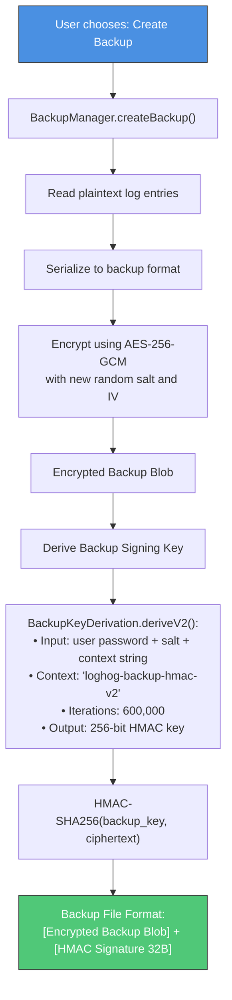
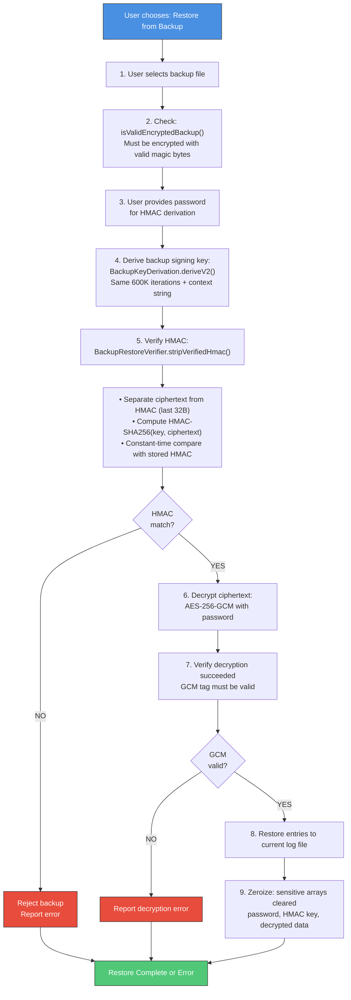

# Security Architecture & Vulnerability Reporting

Thanks for helping keep **.LOG-hog** safe. 

.LOG-hog is a local-first, encrypted desktop application built with security as a core design principle. This document describes the security architecture, threat model, and reporting procedures.

---

## Table of Contents

1. [Security Architecture](#security-architecture)
2. [Encryption & Key Management](#encryption--key-management)
3. [Authentication & Attempt Limiting](#authentication--attempt-limiting)
4. [Backup & Restore Security](#backup--restore-security)
5. [File Permissions & Hardening](#file-permissions--hardening)
6. [Password Policy & Data Cleanup](#password-policy--data-cleanup)
7. [Security Scope Guidance](#security-scope-guidance)
8. [Reporting a Vulnerability](#reporting-a-vulnerability)
9. [Supported Versions](#supported-versions)
10. [Disclosure Policy](#disclosure-policy)

---

## Security Architecture

### Overview

.LOG-hog uses a **multi-layer security model** combining encryption, authentication, access control, and secure memory management:



### Key Principles

1. **Local-First**: All data stays on the user's machine; no cloud sync
2. **Encrypt-By-Default**: User logs must be password-encrypted on the first run
3. **Defense in Depth**: Multiple layers (encryption, permissions, rate limiting, cleanup)
4. **Fail-Secure**: On permission or encryption errors, deny access rather than downgrade
5. **Constant-Time Operations**: MAC and tag comparisons use `MessageDigest.isEqual()`
6. **Memory Cleanup**: Sensitive arrays (keys, passwords) are zeroized after use

---

## Encryption & Key Management

### Algorithm & Parameters

| Property | Value | Rationale |
|----------|-------|-----------|
| **Symmetric Encryption** | AES-256-GCM | Authenticated encryption with 128-bit auth tag |
| **Key Derivation Function** | PBKDF2-HMAC-SHA256 | Standard, vetted KDF resistant to GPU attacks |
| **KDF Iterations** | 600,000 | High iteration count (as of 2026) to resist brute force |
| **IV (Nonce)** | 96 bits, random per encryption | GCM-compliant; uniqueness prevents replay/forgery |
| **Salt** | 128 bits, random per password | Prevents rainbow tables; unique per encrypted file |
| **Key Length** | 256 bits | Maximum AES key size for maximum security margin |

### Encryption Flow

```
User Password (e.g., 20+ chars)
          ↓
   ┌──────────────────┐
   │ Generate Salt    │ ← 128-bit random
   └─────────┬────────┘
             ↓
   ┌─────────────────────────────────────────┐
   │ PBKDF2 (600K iterations, HMAC-SHA256)   │
   │ Input:  password + salt                  │
   │ Output: 256-bit session key              │
   └─────────┬─────────────────────────────────┘
             ↓
   ┌──────────────────┐
   │ Generate IV      │ ← 96-bit random
   └─────────┬────────┘
             ↓
   ┌────────────────────────────────────────────┐
   │ AES-256-GCM Encrypt                         │
   │ Key:       derived from password            │
   │ IV:        random per operation             │
   │ AAD:       (optional, not used currently)   │
   │ Plaintext: log entry content                │
   │ Output:    ciphertext + 128-bit auth tag    │
   └─────────┬──────────────────────────────────┘
             ↓
   ┌─────────────────────────────────────────────────┐
   │ File Format:                                    │
   │   MAGIC(4: "LOGH") + VERSION(1) +              │
   │   SALT_LEN(1) + SALT(16) +                     │
   │   IV_LEN(1) + IV(12) +                         │
   │   CIPHERTEXT + AUTH_TAG(16)                    │
   └─────────┬──────────────────────────────────────┘
             ↓
      Encrypted Log File
```

### Key Derivation Details

**Session Key Derivation:**
- Algorithm: PBKDF2-HMAC-SHA256
- Iterations: 600,000
- Salt: 16 random bytes per file
- Password: User input (minimum 20 characters, see Password Policy)
- Output: 256-bit AES key

**Backup Signing Key Derivation (BackupKeyDerivation.java):**
- Context string: "loghog-backup-hmac-v2"
- Same iteration count (600,000) as primary encryption
- Used to derive HMAC-SHA256 key for backup integrity
- **Legacy support removed**: v1 (120,000 iterations) signatures are rejected

### Decryption & Verification

```
Encrypted File
      ↓
Parse Header:
  • Verify MAGIC = "LOGH"
  • Read VERSION (must be 1)
  • Extract SALT
  • Extract IV
      ↓
User Password
      ↓
PBKDF2 (600K iterations) → Session Key (256-bit)
      ↓
AES-256-GCM Decrypt:
  • Input:  ciphertext, IV, key, auth tag
  • Output: plaintext (if tag verifies)
  • On tag mismatch: throw EncryptionException
      ↓
Plaintext Log Content
```

---

## Authentication & Attempt Limiting

### Startup Authentication Flow



### Manual Unlock (Lock/Unlock during session)



### Attempt Limits & Exit Behavior

| Scenario | Attempt Limit | Exit on 3rd Failure? | Notes |
|----------|---------------|---------------------|-------|
| Startup authentication | 3 per startup | ✅ Yes (exit 1) | Prevents brute-force; user can retry app |
| Manual lock/unlock | None currently | ❌ No | User remains locked but app stays open |
| Lock → Unlock transition | None | ❌ No | User can retry as many times as needed |

---

## Backup & Restore Security

### Backup Creation & Signing



### Backup Restore & Verification



### Legacy Backup Rejection

**Policy**: .LOG-hog **NEVER** supports legacy backup formats:
- v1 PBKDF2 (120,000 iterations) → **REJECTED**
- Weaker key derivations → **REJECTED**
- Fallback cryptography → **NOT PRESENT**

**Rationale**: Accepting legacy formats would create downgrade attacks and maintainability burden. New backups always use v2 (600K).

---

## File Permissions & Hardening

### POSIX File Permissions (Linux/macOS)

**For Regular Files (logs, backups):**
```
Target:   -rw------- (0600)
          Owner: read + write
          Group: (none)
          Others: (none)
```

**For Directories (.loghog, backups/):**
```
Target:   drwx------ (0700)
          Owner: read + write + execute (traverse)
          Group: (none)
          Others: (none)
```

**Implementation:**
```java
// src/security/SecurityFilePolicy.java
if (Files.isDirectory(path)) {
    perms.add(PosixFilePermission.OWNER_EXECUTE);  // ← Required for traversal
}
Files.setPosixFilePermissions(path, perms);
```

### Windows File Permissions

- Best-effort NTFS ACL hardening
- Restricts access to Owner (current user)
- Falls back to `File.setReadable(true, true)` if ACLs unavailable
- **Note**: Some filesystems or USB drives may not support strict ACLs

### Verification & Enforcement

```java
// Check if permissions are correctly set
boolean secure = SecurityFilePolicy.isOwnerOnlyAccessEnforced(path);

// Fail-secure: enforce or throw exception
SecurityFilePolicy.ensureOwnerOnlyPermissionsOrThrow(path);
```

### Platform-Specific Behavior

| Platform | Method | Reliability |
|----------|--------|------------|
| Linux/macOS (ext4, HFS+) | POSIX setPermissions() | High ✅ |
| Windows (NTFS) | ACL setting + setReadable/setWritable | Medium ⚠️ |
| USB/FAT32 | Fallback (no ACLs) | Low ❌ |
| Network shares | Variable | Not supported |

---

## Password Policy & Data Cleanup

### Password Requirements

**For New Encryption:**
- **Minimum length**: 20 characters (enforced by `PasswordPolicy.validateForNewEncryption()`)
- **Character set**: No restrictions (user chose strong passphrases)
- **Entropy**: User responsible; password strength indicator provided in UI

**Example valid passwords:**
```
correct-horse-battery-staple
MyDogAteMyHomework123!@#
supercalifragilisticexpialidocious
```

**Example invalid:**
```
short123        (too short, < 20 chars)
password1234567 (too short, < 20 chars)
```

### Sensitive Data Cleanup (Memory Zeroization)

**What gets zeroized:**
- User passwords (char[]) after KDF
- Derived keys (byte[]) after encryption/decryption
- Plaintext content during decryption
- HMAC keys and computed MACs
- Authentication attempts tracking

**Implementation:**
```java
// CryptoUtils.zeroize()
public static void zeroize(byte[] arr) {
    if (arr != null) Arrays.fill(arr, (byte) 0);
}

public static void zeroize(char[] arr) {
    if (arr != null) Arrays.fill(arr, '\0');
}
```

**On Lock/Shutdown (LogTextEditor.clearSensitiveRuntimeState):**
```
1. Save settings (if needed)
2. Stop clipboard monitoring
3. Clear recent entries from memory
4. Shutdown lock held (released only in finally after clipboard cleanup)
5. Flush encryption context
6. Exit JVM (if on startup exhaustion) or remain locked (if manual lock)
```

---

## Security Scope Guidance

### ✅ In Scope (Report These)

Security vulnerabilities requiring cryptographic or architectural fixes:

- **Encryption/authentication weaknesses**: AES-GCM usage errors, IV collision, nonce reuse
- **Key handling bugs**: Passwords not cleared, keys exposed in logs
- **Plaintext leakage**: Data written unencrypted to disk, logs, temp files, swapfiles
- **PBKDF2 flow issues**: Wrong iteration count, missing salt validation
- **Backup integrity bypass**: HMAC verification skipped, v1 legacy acceptance
- **Lockout bypass**: Attempt counter reset, authentication skipped
- **File permission bypass**: Sensitive files readable by others (when POSIX enforced)
- **Tamper detection**: Corruption not detected during decryption
- **Replay attacks**: Same backup used twice without detection
- **Constant-time failures**: Timing attacks on MAC/tag comparison
- **Clipboard security**: Sensitive data exposed during copy/paste operations
- **Session management**: Session key leaked, reused, or not cleaned up

### ❌ Out of Scope (Do Not Report)

- Issues requiring system compromise (malware, kernel exploit, hardware keylogger)
- User self-exposure from weak OS-level security (e.g., group-readable .loghog/ folder)
- Denial-of-service without security impact (slow encryption, storage exhaustion)
- Social engineering attacks (user tricks self into revealing password)
- Physical attacks (theft of hard drive, cold boot attacks)
- Spectre/Meltdown class issues (mitigation outside app scope)
- Third-party library vulnerabilities with no direct security implication
- Documentation/website typos

### Supported Versions

| Version | Security Support |
|---------|-----------------|
| Latest release | ✅ Receives fixes |
| `main` branch | ✅ Receives fixes |
| Older releases | ❌ No fixes |

---

## Reporting a Vulnerability

### Use Private Vulnerability Reporting

**GitHub provides a private channel:**

1. Navigate to: **https://github.com/johandersson/.LOG-hog/security/advisories/new**
2. Submit your report with:
   - Clear description of the issue and its impact
   - Affected version/commit/OS (Windows/macOS/Linux) and Java version
   - Detailed reproduction steps or proof-of-concept code
   - Expected vs. actual behavior
   - Any logs, stack traces, or screenshots (with secrets/credentials **redacted**)

### If Private Reporting Unavailable

- Open a minimal public issue **without sensitive details**
- Request a private contact path in the issue
- Do **NOT** include reproduction code, credentials, or full stack traces

### What to Include

- **Severity**: Critical / High / Medium / Low (explain impact)
- **Category**: Encryption / Authentication / Permissions / Backup / Other
- **Version affected**: e.g., commit hash, release tag, or "main"
- **Environment**: OS, Java version, filesystem type
- **Reproduction**:
  ```
  1. Create log file with password "xyz"
  2. Lock the app
  3. Attempt to unlock with wrong password
  4. [Observe unexpected behavior]
  ```
- **Expected behavior**: "App should exit after 3 failed attempts"
- **Actual behavior**: "App allows unlimited attempts"
- **Logs/Traces**: `~/.loghog/loghog.log` (with sensitive data removed)

---

## Disclosure Policy

We follow **responsible disclosure**:

1. **Private Report Received** → We acknowledge within 2 business days
2. **Investigation** → We investigate and confirm the issue
3. **Fix Development** → We develop and test a patch
4. **Pre-Release Notification** → We notify you of the fix (optional)
5. **Release** → We publish a security fix update
6. **Public Advisory** → We post a CVE/advisory and credit the reporter (if desired)

**Expected timeline**: 30–90 days from report to fix, depending on complexity

**Responsible Disclosure Terms:**
- Allow time for a fix before public disclosure
- Do not publicly disclose until a fix is released (or 90 days pass)
- Avoid exploiting the vulnerability for access, data exfiltration, or disruption
- Do not contact users or third parties before we publish the fix

---

## Safe Harbor

We appreciate good-faith security research. **We will not pursue legal action against researchers who:**

- Discover vulnerabilities through authorized testing
- Report issues privately and in good faith
- Avoid privacy violations, data destruction, disruption, or social engineering
- Give us reasonable time to develop a fix before disclosure

**Thank you for helping keep .LOG-hog secure! 🔒**
